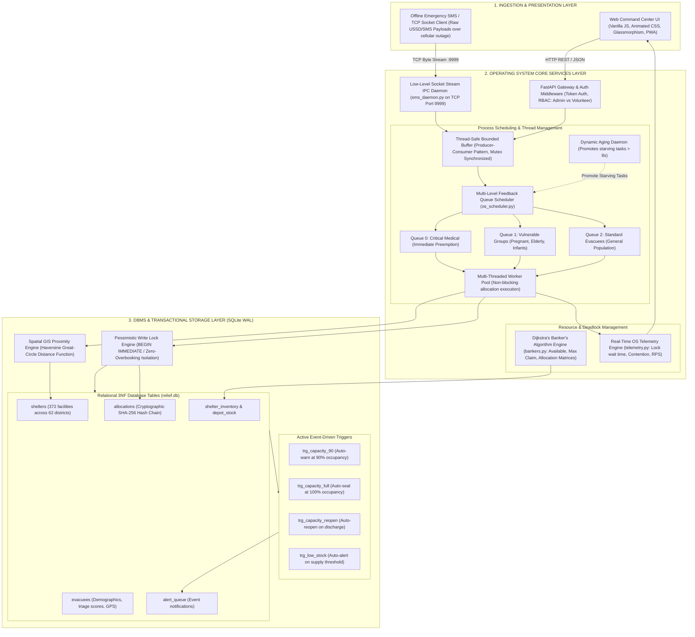

# Disaster Resource Allocation & Shelter Management System
### OSDBMS PBL 5th Semester Project | Graphic Era (Deemed to be University)
**Team ID:** `OSDBMS-V-2026-T135`  
**Team Members:** Anushreya Tomar (Lead), Akanchha Singh, Ishani Nautiyal, Simarjeet Kaur  
**Mentor:** Dr. Ankit Tomar  

---

## 📌 Project Overview
This platform is a high-performance **Operating Systems & Database Management Systems (OSDBMS)** engineering system designed for real-time disaster resource allocation, evacuee priority triage, and shelter occupancy management during emergency situations (floods, earthquakes, landslides).

Unlike generic web CRUD applications, this project explicitly implements **OS kernel mechanisms** (CPU scheduling, process preemption, thread synchronization, IPC socket daemons) and **advanced DBMS engine features** (spatial GIS distance calculations, pessimistic ACID transaction locks, active database triggers, and cryptographic audit hashing).

---

## 🏛️ System Architecture

The platform follows a three-tier decoupled architecture: **Ingestion & Presentation Layer**, **OS Core Services Layer**, and **DBMS Storage Engine Layer**.



---

## 🛠️ Operating System (OS) Concepts Implemented

1. **Multi-Level Feedback Queue (MLFQ) Priority Scheduler with Aging:**
   - **3-Tier Triage Queues:**
     - **Queue 0 (Critical Medical):** Severe injuries, hemorrhages, unconscious evacuees — prioritized with immediate execution.
     - **Queue 1 (Vulnerable Population):** Third-trimester pregnancy, elderly ($\ge 65$), unaccompanied minors, wheelchair users.
     - **Queue 2 (General Displaced Population):** Standard round-robin processing.
   - **Dynamic Aging Daemon (Starvation Prevention):** Background thread monitors Queue 2. Any evacuee waiting longer than 8 seconds is dynamically promoted to Queue 1 with an `[AGED PROMOTED]` flag, mathematically eliminating process starvation under sustained high-priority load.
2. **Thread Synchronization & Bounded Buffer:**
   - Field ingestion feeds (HTTP REST endpoints and raw SMS socket streams) write into a thread-safe Producer-Consumer Bounded Buffer synchronized using POSIX/Python `threading.Lock` and `threading.Condition` primitives to prevent race conditions and queue overflow during mass evacuations.
3. **Deadlock Avoidance (Dijkstra's Banker's Algorithm):**
   - Evaluates multi-resource allocation bundles (Emergency Beds + Oxygen Concentrators + ICU Ventilators + Transport Ambulances) before approving resupply claims from shelters.
   - Maintains **Available Vector ($V_A$)**, **Max Claim Matrix ($M$)**, **Allocation Matrix ($A$)**, and **Need Matrix ($N = M - A$)** to guarantee the entire relief network remains in a provably Safe State.
4. **Low-Level Socket Stream IPC Daemon:**
   - Runs a dedicated TCP socket listener on **Port 9999** (`sms_daemon.py`) to parse raw, delimited SMS/USSD text payloads when cellular 4G/5G data networks fail during natural disasters.
5. **Real-Time System Telemetry & Kernel Metrics:**
   - Background telemetry service (`telemetry.py`) samples active thread pool saturation, database lock contention rates, average/peak mutex wait times (in milliseconds), and transactions per second.

---

## 🗄️ Database Management System (DBMS) Concepts Implemented

1. **Spatial GIS Distance & Proximity Engine:**
   - Implements native Haversine great-circle spherical distance calculations in SQL:
     $$d = 2R \arcsin\left(\sqrt{\sin^2\left(\frac{\Delta \phi}{2}\right) + \cos(\phi_1)\cos(\phi_2)\sin^2\left(\frac{\Delta \lambda}{2}\right)}\right)$$
   - Indexes and filters shelters within a dynamic 5km–50km radius matching required medical facilities (ICU, medical wards, wheelchair accessibility).
2. **Pessimistic Concurrency Locking (`BEGIN IMMEDIATE`):**
   - Implements strict database write transaction locks (`BEGIN IMMEDIATE` in SQLite WAL mode) to guarantee ACID serializability.
   - Prevents race conditions and phantom overbooking when hundreds of parallel threads attempt to reserve the last remaining bed in a shelter.
3. **Active Database Event Triggers:**
   - `trg_capacity_90`: Automatically inserts a high-capacity warning into `alert_queue` and updates shelter status to `CRITICAL_90` when occupancy hits $\ge 90\%$.
   - `trg_capacity_full`: Automatically flags the shelter as `FULL` at 100% occupancy and seals it from new non-emergency admissions.
   - `trg_capacity_reopen`: Automatically reopens the shelter and resets status when evacuees are transferred or discharged.
   - `trg_low_stock`: Fires an automated inventory replenishment alert when essential rations or medical supplies drop below safety thresholds.
4. **Cryptographic SHA-256 Audit Hashing (Tamper-Proof Ledger):**
   - Every supply allocation and evacuee assignment generates a continuous cryptographic hash chain:
     $$\text{Hash}_n = \text{SHA-256}(\text{Hash}_{n-1} \,\|\, \text{EvacueeID} \,\|\, \text{ShelterID} \,\|\, \text{Timestamp} \,\|\, \text{Action})$$
   - Exposes any unauthorized direct database tampering or relief aid diversion through an automated verification scan.
5. **Real Indian Emergency Datasets & 3NF Normalized Schema:**
   - Normalized 3NF relational schema pre-populated with **372 verified shelters across 62 districts** (including Kerala Floods 2018 camps, Chennai cyclone shelters, Assam flood hubs, and Uttarakhand landslide shelters) and 1,860 supply inventory items.

---

## 🌟 Detailed Feature Breakdown (8 Core Modules)

### 1. Emergency Evacuee Intake & Medical Triage
- Multi-factor priority classification assigning evacuees to Priority 0, 1, or 2 based on vital medical indicators.
- Automatic GIS matching finding the closest viable shelter with available beds and matching capabilities (ICU/wheelchair).
- Network idempotency via unique request UUIDs preventing duplicate entries during unstable field connections.

### 2. Interactive Shelter Capacity & Facility Management
- Command center view of all 372 shelters with live occupancy progress bars (`.occBar`).
- High-contrast visual status badges (`OPEN`, `CRITICAL_90`, `FULL`, `CLOSED`).
- District-wise quick filtering and facility capability toggles (ICU, medical unit, wheelchair ramp).

### 3. Evacuee Demographic Registry & Family Tracking
- Real-time directory searchable by name, age, district, medical condition, or assigned shelter.
- Family unit preservation logic ensuring displaced families are accommodated in the same shelter.
- Discharge and transfer management restoring shelter capacity in real time.

### 4. Multi-Level Feedback Queue (MLFQ) Live Visualizer
- Real-time visualization of $Q_0$ (Critical), $Q_1$ (Vulnerable), and $Q_2$ (Standard).
- Live counter tracking dynamic aging promotions from $Q_2 \rightarrow Q_1$.
- Thread pool execution monitoring showing queue wait times and dispatch latencies.

### 5. Automated Emergency Alert Queue
- Dedicated event feed populated autonomously by database triggers (zero polling overhead).
- Prioritized alert categorizations: Capacity 90%, Shelter Full, Shelter Reopened, Low Stock.
- One-click alert acknowledgment for municipal relief coordinators.

### 6. Deadlock-Free Multi-Resource Allocation (Banker's Algorithm)
- Safe-state simulation for multi-resource emergency loans (Oxygen Concentrators, Emergency Beds, Ventilators, Ambulances).
- Matrix display: Total Depot Stock, Allocated Resources, Maximum Claim, and Current Need.
- Prevents resource exhaustion and inter-shelter deadlocks during supply crises.

### 7. Tamper-Proof Cryptographic Audit Ledger
- Complete chronological audit log of all relief transactions.
- Block hash visualization with previous hash references and transaction payloads.
- **One-Click Cryptographic Audit:** Scans all records and mathematically verifies that zero records have been altered post-facto.

### 8. Live OS Telemetry & Concurrency Benchmark Center
- System health gauges: Active thread workers, lock wait time (ms), lock contention rate, and throughput (RPS).
- **Built-in Concurrent Stress Test:** Fires 50 to 500 concurrent worker threads against a single shelter to demonstrate zero overbooking and 100% ACID transaction compliance.

---

## 📊 OS & DBMS Academic Syllabus Alignment

| Subject | Syllabus Concept | Practical Implementation in Project | Source Code File |
| :--- | :--- | :--- | :--- |
| **OS** | **CPU Scheduling** | Multi-Level Feedback Queue (MLFQ) with 3 priority queues | `backend/os_scheduler.py` |
| **OS** | **Starvation Prevention** | Dynamic Aging Daemon promoting waiting evacuees after 8s | `backend/os_scheduler.py` |
| **OS** | **Process Synchronization** | Mutex-synchronized Producer-Consumer Bounded Buffer | `backend/os_scheduler.py` |
| **OS** | **Deadlock Avoidance** | Dijkstra's Banker's Algorithm with matrix safety analysis | `backend/bankers.py` |
| **OS** | **Inter-Process Comm.** | Low-level TCP socket stream listener on Port 9999 | `backend/sms_daemon.py` |
| **OS** | **System Telemetry** | Lock wait time sampling, thread pool tracking, RPS monitor | `backend/telemetry.py` |
| **DBMS** | **Transaction Isolation** | Pessimistic write locking (`BEGIN IMMEDIATE`) | `backend/database.py` |
| **DBMS** | **Active DB Triggers** | 4 SQL triggers for 90% capacity, full capacity, reopening & stock | `backend/schema.sql` |
| **DBMS** | **Spatial GIS Indexing** | Haversine spherical distance function implemented in SQL | `backend/database.py` |
| **DBMS** | **Cryptographic Audit** | Continuous SHA-256 hash chaining on all allocation records | `backend/audit.py` |
| **DBMS** | **Schema Normalization** | 3NF relational model with foreign keys & check constraints | `backend/schema.sql` |
| **DBMS** | **Write-Ahead Logging** | SQLite WAL mode (`PRAGMA journal_mode=WAL`) | `backend/database.py` |

---

## 🚀 How to Run in VS Code

### Step 1: Open Workspace in VS Code
Open VS Code, select **File > Open Folder...**, and select:  
`c:\Users\anushreya\OneDrive\Desktop\pbl_phase2`

### Step 2: Initialize Database Data
Open the terminal in VS Code (`Ctrl + ~`) and run:
```bash
python -c "from backend.database import init_db; from backend import seed; init_db(); seed.seed()"
```
*(Or run `python scripts/seed_data.py`)*

### Step 3: Launch the Server
Run the FastAPI application server:
```bash
python -m uvicorn backend.main:app --reload --port 8000
```

### Step 4: Open Interactive Web Dashboard
Open your web browser and go to:  
👉 **[http://127.0.0.1:8000](http://127.0.0.1:8000)**

---

## 🧪 How to Demonstrate to Evaluators

### Demo User Accounts
- **Admin:** `admin` / `admin123` (Full access across all 8 modules)
- **Volunteer:** `volunteer` / `volunteer123` (Intake, Shelters, Evacuees, Queue, Alerts)

### Step-by-Step Viva Demonstration Workflow:
1. **Show Concurrency & Pessimistic Locking:**
   - Log in as `admin` and open the **System Telemetry** tab.
   - Click **"🚀 Run Load Test"** (50 to 500 parallel threads).
   - Point out to the evaluator that **Zero Overbooking Integrity** is maintained: `available_beds` never drops below 0 and no two threads reserve the same slot.
2. **Show OS MLFQ Scheduler & Aging Daemon:**
   - Go to **Intake** and submit a Priority 2 (standard) evacuee.
   - Switch to the **MLFQ Queue** tab: observe the evacuee in Queue 2.
   - Wait 8 seconds: Watch the OS Aging Daemon dynamically promote the evacuee to Queue 1 with an **`[AGED PROMOTED]`** badge to prevent starvation!
3. **Show Offline Socket Stream IPC Daemon:**
   - Click **"📡 Send Socket Stream to IPC Daemon"**.
   - Show how the low-level TCP socket listener on Port 9999 decodes raw SMS strings and allocates beds in real-time without web internet.
4. **Show GIS Spatial Buffer Map:**
   - Click on shelter markers on the map to display 5km proximity radius circles, remaining beds, oxygen cylinders, and contact numbers.
5. **Show Deadlock Avoidance (Banker's Algorithm):**
   - Open the **Resources** tab. Show how the Available vector, Max claim matrix, and Need matrix dynamically compute safe execution states before granting loans.
6. **Show Tamper-Proof Cryptographic Hash Chain:**
   - Open the **Audit** tab. Click **"Verify Cryptographic Chain"** to show real-time verification of the SHA-256 block chain.
